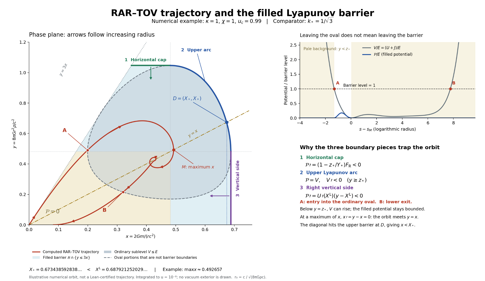

## Kinetic moment estimates and a one-sided Lyapunov barrier for the relativistic fermionic Michie–King equation

Authors:

Dorota Bors — Department of Differential Equations and Computer Science,
Faculty of Mathematics and Computer Science, University of Łódź, Łódź, Poland.

Robert Stańczy — Mathematical Institute, University of Wrocław,
Wrocław, Poland.

This package contains the LaTeX source, compiled paper, and editable figure
for the cutoff Ruffini–Argüelles–Rueda (RAR), or relativistic fermionic
Michie–King, equation of state.

The paper develops kinetic moment identities, endpoint asymptotics, a
comparison with a linear equation of state, and a filled one-sided Lyapunov
barrier for the Tolman–Oppenheimer–Volkoff (TOV) system. For regular static
isotropic configurations, the resulting compactness bound is approximately
2Gm(r)/(r c²) < 0.6734385929. If a finite surface exists, the corresponding
mass–radius estimate is R > 2.9698327676 GM/c². The precise hypotheses and
exact definitions of the constants are stated in the manuscript.

## RAR–TOV trajectory and Lyapunov barrier

The red curve is an illustrative numerical trajectory.
The filled Lyapunov barrier gives the compactness bound
2Gm(r)/(rc²) < X* ≈ 0.67343859.
The numerical trajectory itself is not Lean-certified.

The included PDF has 22 pages.

Package contents

Extract the ZIP before opening or compiling its source. Keep the files in
their existing relative locations inside RAR_Lyapunov_Appendix_C/.

File

Purpose

README.md

This package guide.

rar-lyapunov-mass-radius.tex

Main article, including the introduction, acknowledgments, bibliography, and Appendices A–C.

rar-lyapunov-mass-radius.pdf

Compiled article.

graphics/filled-barrier.tex

Editable TikZ/PGFPlots source for the article's figure.

graphics/filled-barrier-standalone.tex

Wrapper for compiling the figure separately.

graphics/filled-barrier-standalone.pdf

Compiled vector figure.

Makefile

Optional commands for building the article and figure.

Appendices

Appendix A — Correction of the logarithmic coefficient.
Explains the coefficient required in the linear-comparator Lyapunov
potential.

Appendix B — The relativistic Michie–King/RAR equation of state from
slide 34. Presents the density and pressure integrals and their dilute
and relativistic endpoint regimes.

Appendix C — Direct density–pressure estimates in enthalpy variables.
Starts from the formulas of Bors and Stańczy and develops the
density–pressure lemma, compressibility and slope estimates, endpoint
asymptotics, the TOV equations in enthalpy form, and the comparison
leading to the filled barrier.

Requirements

Use a full TeX Live or MiKTeX installation, or Overleaf, with pdfLaTeX.

The article uses fontenc, inputenc, lmodern, microtype, geometry,
amsmath, amssymb, amsthm, mathtools, booktabs, tikz,
pgfplots, and hyperref. PGFPlots is configured with compatibility
level 1.18. The separate figure wrapper also requires standalone.

The bibliography is embedded in the article source; no separate .bib
file, BibTeX run, or Biber run is needed. latexmk and Make are optional
build conveniences.

Compile the article locally

Open a terminal in the extracted RAR_Lyapunov_Appendix_C folder and run:

latexmk -pdf -interaction=nonstopmode -halt-on-error rar-lyapunov-mass-radius.tex

Alternatively, run pdfLaTeX twice to resolve references:

pdflatex -interaction=nonstopmode -halt-on-error rar-lyapunov-mass-radius.tex
pdflatex -interaction=nonstopmode -halt-on-error rar-lyapunov-mass-radius.tex

Both methods write rar-lyapunov-mass-radius.pdf in the same folder.
If references remain unresolved after an edit, run pdfLaTeX again or use
latexmk to manage the required passes.

Compile on Overleaf

Create a project by uploading RAR_Lyapunov_Appendix_C.zip.

Select rar-lyapunov-mass-radius.tex inside the extracted project
folder as the main document.

Choose pdfLaTeX as the compiler and recompile.

Keep the graphics folder beside the main source file.

Edit or compile the figure

Edit graphics/filled-barrier.tex to change the figure. The main article
reads this TikZ source directly, so recompiling the article incorporates
the changes.

To regenerate the separate vector PDF, run from the package folder:

cd graphics
pdflatex -interaction=nonstopmode -halt-on-error filled-barrier-standalone.tex

The result is graphics/filled-barrier-standalone.pdf. The article does
not require this separate PDF to compile.

If Make and latexmk are installed, the supplied Makefile provides:

make paper
make figure
make

The last command builds both the article and the standalone figure.

Subject classifications

MSC2020: Primary 83C55; Secondary 34C11, 34A40, 85A15.

PACS: 04.40.Dg; 95.35.+d.

Acknowledgments

The manuscript credits ChatGPT (Astra) for the kinetic-moment lemma
and acknowledges AI assistance with LaTeX typesetting

Verified with Lean 4.35.0-rc3 / Mathlib 5e72202a: compilation succeeds with zero errors. All theorem statements are preserved; no sorry, admit, or custom axioms were added. Appendix C not verified as auxilliary.
